# gnome-desk-widgets

Standalone desktop widgets for Ubuntu GNOME. Each widget is an ordinary GTK4
window that draws itself with cairo — no GNOME Shell extension, nothing touches
the top bar, no API keys, no login, no account.

## Widgets

| | |
| --- | --- |
| **Clock** — large time, date, optional seconds. Styles: `plain`, `boxed`, `split`. | 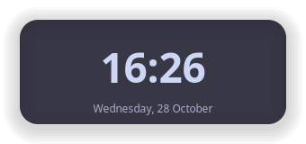 |
| **System stats** — CPU, RAM and disk from `/proc`. Styles: `bar`, `ring`, `number`; the value is printed beside every gauge. | 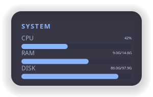 |
| **GitHub streak** — contribution grid in GitHub's 7-row layout, current and longest streak. Reads the public contributions page. | 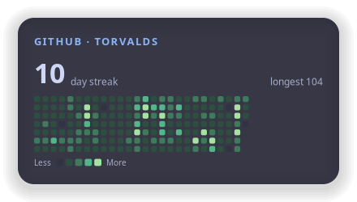 |
| **LeetCode streak** — the same grid in LeetCode's accent colours, from the public GraphQL submission calendar. | 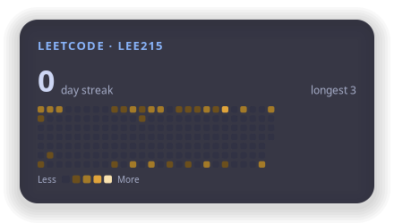 |

More styles, shapes and presets:

| Split clock | High contrast | Ring gauges | Number gauges |
| --- | --- | --- | --- |
| 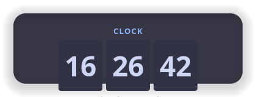 | 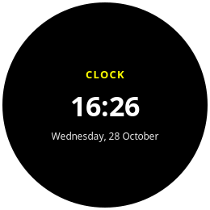 | 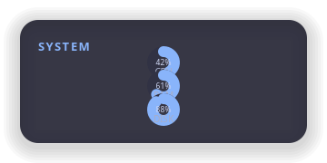 | 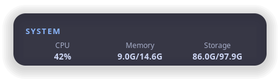 |

| Horizontal gauges | Light preset + squircle | Reordered + per-element colours | Diamond cells | Offline / stale |
| --- | --- | --- | --- | --- |
| 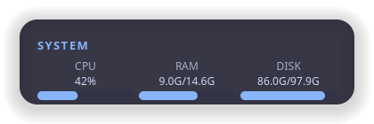 | 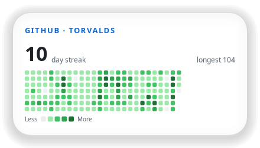 | 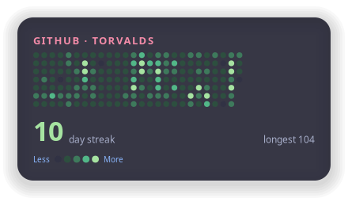 | 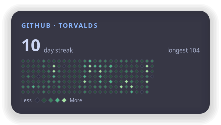 |  |

## Install

System packages (not installed for you):

```bash
sudo apt install python3-gi python3-gi-cairo gir1.2-gtk-4.0 fonts-jetbrains-mono
```

Then the package itself. A virtualenv must see the system GTK bindings, so create
it with `--system-site-packages`:

```bash
git clone https://github.com/himayurjogade/gnome-desk-widgets.git
cd gnome-desk-widgets
python3 -m venv --system-site-packages .venv
source .venv/bin/activate
pip install -e .
```

`requirements.txt` lists the same two Python dependencies for people not on apt.

## Run

```bash
python3 -m desk_widgets.app clock     # one widget
python3 -m desk_widgets.app all       # every widget
python3 -m desk_widgets.app list      # what is available
desk-widgets github leetcode          # same thing, via the console script
```

All widgets share one process. Launching again talks to the running instance
over D-Bus, so `desk-widgets system` adds a window to the running set, and:

```bash
desk-widgets reload                   # re-read the config, redraw everything
```

Drag a widget to move it. `Escape` closes the focused widget. Hover a grid cell
for the exact count and date; hover anything else for the full value.

### Usernames

The streak widgets need a username, nothing else:

```toml
# config/widgets/github.toml
[github]
username = "your-github-name"

# config/widgets/leetcode.toml
[leetcode]
username = "your-leetcode-name"
```

GitHub data comes from `https://github.com/users/<username>/contributions`
(the `data-date` / `data-level` cells, with counts from the tooltips). LeetCode
data comes from `https://leetcode.com/graphql`
(`matchedUser.userCalendar.submissionCalendar`). Both are public: no token, no
login. The shipped configs use example public accounts (`torvalds`, `lee215`)
so the widgets show something on the first run — change them to yours.

### Offline behaviour

Fetches run on a background thread with a timeout; the UI never blocks. Every
good response is cached in `~/.cache/desk-widgets/`. If a fetch fails, the
widget keeps drawing the cached grid and marks it `stale · 2h`, or shows
`offline` if there is no cache yet. A clear warning naming the failure is
logged, and nothing crashes.

### Autostart (optional, not installed for you)

Save this as `~/.config/autostart/desk-widgets.desktop`:

```ini
[Desktop Entry]
Type=Application
Name=desk-widgets
Exec=/home/you/gnome-desk-widgets/.venv/bin/desk-widgets all
X-GNOME-Autostart-enabled=true
```

## Configuration

Config is TOML. Changes apply on restart or `desk-widgets reload`.

Load order, later wins:

```
built-in defaults  ->  presets/<preset>.toml  ->  theme.toml  ->  widgets/<widget>.toml
```

The repo's `config/` directory is used as-is. To keep your settings outside the
repo, copy it to `~/.config/desk-widgets/` (that location wins if it has a
`theme.toml`), or point `DESK_WIDGETS_CONFIG` at any directory.

```
config/
  theme.toml            global look
  presets/*.toml        colour presets
  widgets/clock.toml    per-widget overrides
  widgets/system.toml
  widgets/github.toml
  widgets/leetcode.toml
```

Every option below is valid in `theme.toml` and in any `widgets/*.toml`.
A bad value falls back to the default and logs a warning naming the option.

### Presets

`preset = "..."` in `theme.toml` loads colours and grid palettes from
`config/presets/`. Fourteen ship:

- **Dark** — `catppuccin-mocha` (default), `tokyo-night`, `gruvbox`, `nord`,
  `dracula`, `rose-pine`, `everforest`, `one-dark`, `monokai`,
  `solarized-dark`, `high-contrast`
- **Light** — `catppuccin-latte`, `github-light`, `solarized-light`

Anything you set explicitly still wins over the preset, and a preset can be set
per widget (a Nord clock beside a Dracula streak grid is fine).

All fourteen pass WCAG AA (4.5:1) for text, muted text and accent on their own
background — enforced by a test, not a promise. Your own colours are checked too:
a low-contrast combination logs a warning naming the role and the ratio.

Follow the desktop's light/dark setting instead of picking one:

```toml
preset = "tokyo-night"           # used when the desktop is dark
preset_light = "github-light"    # used when it is light
follow_system = true             # switches live, no restart
```

### Every option

| Option | Default | Allowed | Meaning |
| --- | --- | --- | --- |
| `preset` | `"catppuccin-mocha"` |  | Colour preset from `config/presets/` |
| `preset_light` | `"catppuccin-latte"` |  | Preset used when the desktop is light and `follow_system` is on |
| `follow_system` | `false` | `true`, `false` | Follow the GNOME light/dark setting, live |
| `size.width` | `320` | 40–4000 | Window width in px (before scale) |
| `size.height` | `150` | 40–4000 | Window height in px (before scale) |
| `size.scale` | `1.0` | 0.25–4.0 | Multiplies size, fonts, padding, radii |
| `position.anchor` | `"top-right"` | `bottom-left`, `bottom-right`, `center`, `top-left`, `top-right` | Preferred corner (advisory on Wayland) |
| `position.margin_x` | `32` |  | Gap from the anchor corner, px (advisory) |
| `position.margin_y` | `32` |  | Gap from the anchor corner, px (advisory) |
| `position.monitor` | `0` |  | Monitor index (advisory) |
| `position.remember` | `true` | `true`, `false` | Restore the last dragged position (advisory) |
| `shape.kind` | `"rounded"` | `circle`, `cut`, `diamond`, `hexagon`, `pill`, `ring`, `rounded`, `square`, `squircle` | Window outline |
| `shape.radius` | `20.0` |  | Corner radius for `rounded`, `squircle`, `cut` |
| `shape.ring_width` | `12.0` |  | Stroke width for `ring` and ring gauges |
| `shape.cell` | `"rounded"` | `bar`, `circle`, `diamond`, `dot`, `hexagon`, `pill`, `rounded`, `square` | Grid-cell / inner-box shape |
| `shape.cell_radius` | `2.0` |  | Corner radius for rounded cells |
| `shape.cell_size` | `11.0` |  | Grid cell size, px (shrinks to fit) |
| `shape.cell_gap` | `3.0` |  | Gap between grid cells, px |
| `colors.background` | `"#1e1e2e"` |  | Window fill |
| `colors.text` | `"#cdd6f4"` |  | Primary text |
| `colors.muted` | `"#a6adc8"` |  | Secondary text |
| `colors.accent` | `"#89b4fa"` |  | Titles, bars and ring gauges |
| `colors.track` | `"#313244"` |  | Gauge/bar background, empty grid days |
| `colors.border` | `"#45475a"` |  | Border stroke |
| `colors.shadow` | `"#000000"` |  | Shadow tint |
| `colors.title` | `""` |  | Override for the title colour (empty = inherit accent) |
| `colors.value` | `""` |  | Override for the value colour (empty = inherit text) |
| `colors.date` | `""` |  | Override for the date colour (empty = inherit muted) |
| `colors.legend` | `""` |  | Override for the legend colour (empty = inherit muted) |
| `colors.label` | `""` |  | Override for the label colour (empty = inherit muted) |
| `colors.hover` | `""` |  | Override for the hover colour (empty = inherit text) |
| `colors.grid_empty` | `""` |  | Override for the grid empty colour (empty = inherit track) |
| `colors.grid_border` | `""` |  | Override for the grid border colour (empty = none) |
| `opacity.background` | `0.88` | 0.0–1.0 | Background alpha, 0-1 (text unaffected) |
| `gradient.enabled` | `false` | `true`, `false` | Two-stop background gradient |
| `gradient.start` | `"#1e1e2e"` |  | Gradient first stop |
| `gradient.end` | `"#313244"` |  | Gradient second stop |
| `gradient.angle` | `135.0` |  | Gradient angle, degrees |
| `bar_gradient.enabled` | `false` | `true`, `false` | Two-stop gradient for bars, rings, boxes |
| `bar_gradient.start` | `"#89b4fa"` |  | Bar gradient first stop |
| `bar_gradient.end` | `"#f5c2e7"` |  | Bar gradient second stop |
| `bar_gradient.angle` | `0.0` |  | Bar gradient angle, degrees |
| `border.width` | `0.0` |  | Border width, px (0 = none) |
| `border.color` | `"#45475a"` |  | Border colour |
| `shadow.enabled` | `true` | `true`, `false` | Drop shadow on/off |
| `shadow.blur` | `18.0` |  | Shadow spread, px |
| `shadow.offset_x` | `0.0` |  | Shadow x offset, px |
| `shadow.offset_y` | `4.0` |  | Shadow y offset, px |
| `shadow.color` | `"#00000099"` |  | Shadow colour (alpha allowed) |
| `font.family` | `"JetBrains Mono"` |  | Font family for every role |
| `font.title.size` | `13.0` |  | Title text size, px |
| `font.title.weight` | `"bold"` |  | Title weight (name or 100-900) |
| `font.title.letter_spacing` | `1.5` |  | Title letter spacing, px |
| `font.value.size` | `46.0` |  | Value text size, px |
| `font.value.weight` | `"bold"` |  | Value weight (name or 100-900) |
| `font.value.letter_spacing` | `0.0` |  | Value letter spacing, px |
| `font.small.size` | `12.0` |  | Small text size, px |
| `font.small.weight` | `"normal"` |  | Small weight (name or 100-900) |
| `font.small.letter_spacing` | `0.0` |  | Small letter spacing, px |
| `font.date.size` | `12.0` |  | Date text size, px |
| `font.date.weight` | `"normal"` |  | Date weight (name or 100-900) |
| `font.date.letter_spacing` | `0.0` |  | Date letter spacing, px |
| `font.legend.size` | `10.0` |  | Legend text size, px |
| `font.legend.weight` | `"normal"` |  | Legend weight (name or 100-900) |
| `font.legend.letter_spacing` | `0.0` |  | Legend letter spacing, px |
| `layout.padding` | `20.0` |  | Inner padding, px |
| `layout.spacing` | `6.0` |  | Gap between elements, px |
| `layout.align` | `"center"` | `center`, `end`, `start` | Horizontal alignment of content |
| `layout.padding_x` | `0.0` |  | Horizontal padding override (0 = use padding) |
| `layout.padding_y` | `0.0` |  | Vertical padding override (0 = use padding) |
| `layout.title_align` | `""` | `center`, `end`, `start` | Title alignment (empty = use align) |
| `layout.value_align` | `""` | `center`, `end`, `start` | Value alignment (empty = use align) |
| `layout.direction` | `"vertical"` | `horizontal`, `vertical` | Stack system gauges down or across |
| `layout.order` | `["title", "value", "date", "grid", "legend"]` |  | Draw order of elements, top to bottom |
| `show.title` | `true` | `true`, `false` | Show the widget title |
| `show.value` | `true` | `true`, `false` | Show the main value (time, streak, gauges) |
| `show.date` | `true` | `true`, `false` | Show the date line (clock) |
| `show.seconds` | `false` | `true`, `false` | Show seconds (clock) |
| `show.grid` | `true` | `true`, `false` | Show the contribution grid |
| `show.legend` | `true` | `true`, `false` | Show the Less/More legend |
| `show.longest_streak` | `true` | `true`, `false` | Show the longest streak |
| `behavior.stats_interval` | `2.0` | 0.2–3600 | Local refresh, seconds (clock, system) |
| `behavior.remote_interval` | `900.0` | 30–86400 | Network refresh, seconds (GitHub, LeetCode) |
| `behavior.grid_weeks` | `26` | 1–53 | Weeks of history in the grid |
| `behavior.week_start` | `"sunday"` | `monday`, `sunday` | First row of the grid week |
| `behavior.reduced_motion` | `false` | `true`, `false` | Disable animated transitions and the hover highlight |
| `behavior.text_scaling` | `true` | `true`, `false` | Follow the system font scale |
| `palettes.github` | `["#161b22", "#0e4429", "#006d32", "#26a641", "#39d353"]` |  | GitHub grid colours, level 0 first |
| `palettes.leetcode` | `["#2b2b2b", "#2f4f3a", "#3c6e47", "#ffa116", "#ffc53d"]` |  | LeetCode grid colours, level 0 first |
| `clock.style` | `"plain"` | `boxed`, `plain`, `split` | Clock layout |
| `clock.time_format` | `"%H:%M"` |  | strftime for the time |
| `clock.seconds_format` | `"%H:%M:%S"` |  | strftime when seconds are on |
| `clock.date_format` | `"%A, %d %B"` |  | strftime for the date |
| `clock.title` | `"CLOCK"` |  | Clock title text |
| `system.metrics` | `["cpu", "ram", "disk"]` |  | Which gauges to show, in order |
| `system.style` | `"bar"` | `bar`, `number`, `ring` | Gauge style |
| `system.disk_path` | `"/"` |  | Mount point measured by the disk gauge |
| `system.bar_height` | `10.0` |  | Bar thickness, px |
| `system.ring_size` | `54.0` |  | Ring gauge diameter, px |
| `system.title` | `"SYSTEM"` |  | System widget title text |
| `system.labels.cpu` | `"CPU"` |  | Label printed next to the CPU gauge |
| `system.labels.ram` | `"RAM"` |  | Label printed next to the RAM gauge |
| `system.labels.disk` | `"DISK"` |  | Label printed next to the disk gauge |
| `github.username` | `"octocat"` |  | GitHub user to read (public page, no token) |
| `github.palette` | `"github"` |  | Which `[palettes]` entry colours the grid |
| `github.title` | `"GITHUB"` |  | GitHub widget title text |
| `github.timeout` | `8.0` |  | Network timeout, seconds |
| `leetcode.username` | `"leetcode"` |  | LeetCode user to read (public API, no token) |
| `leetcode.palette` | `"leetcode"` |  | Which `[palettes]` entry colours the grid |
| `leetcode.title` | `"LEETCODE"` |  | LeetCode widget title text |
| `leetcode.timeout` | `8.0` |  | Network timeout, seconds |
| `leetcode.levels` | `[1, 3, 6, 10]` |  | Submissions per day needed for levels 1-4 |

`palettes` also accepts your own names — add `palettes.ocean = [...]` and point
`github.palette = "ocean"` at it.

### Examples

A translucent pill clock in Nord colours, bigger, without the date:

```toml
# config/widgets/clock.toml
preset = "nord"

[size]
width = 420
height = 120
scale = 1.25

[shape]
kind = "pill"

[opacity]
background = 0.6

[show]
date = false
seconds = true

[clock]
style = "split"
```

A year of GitHub history in circular cells, no legend:

```toml
# config/widgets/github.toml
[size]
width = 760
height = 240

[shape]
cell = "circle"
cell_size = 12.0

[behavior]
grid_weeks = 52
week_start = "monday"

[show]
legend = false
```

Per-element colours, order and alignment — every element can be recoloured,
reordered or moved independently:

```toml
# config/widgets/github.toml
[colors]
title = "#f38ba8"       # empty = inherit accent
value = "#a6e3a1"       # inherit text
label = "#7f849c"       # inherit muted
legend = "#89b4fa"
grid_empty = "#1a1a28"  # inherit track
grid_border = "#45475a" # empty = no outline
hover = "#f9e2af"       # outline on the cell under the pointer

[layout]
order = ["title", "grid", "value", "legend"]   # grid above the streak number
title_align = "start"
value_align = "end"
padding_x = 28.0
padding_y = 16.0
```

Gauges across instead of down, with your own labels:

```toml
# config/widgets/system.toml
[size]
width = 460
height = 140

[layout]
direction = "horizontal"

[system]
style = "number"

[system.labels]
ram = "Memory"
disk = "Storage"
```

If an element looks clipped, the content is taller than the window: raise
`size.height` or lower the font sizes. Grid cells shrink on their own to fit.

## Accessibility

- No account, login or API key for any widget.
- Every preset meets WCAG AA contrast; `high-contrast` is solid black and white
  with a 2px border and no shadow.
- Colour is never the only signal: the number is printed beside every gauge,
  streak counts are printed next to the grid, every grid cell has a tooltip with
  its exact count and date, and the cell under the pointer is outlined.
- Your own colour choices are contrast-checked at load. A failing combination
  logs `colors.muted (#5a5a6a) has 3.1:1 contrast on the background, below the
  WCAG AA minimum of 4.5:1` instead of silently shipping unreadable text.
- Windows and their content expose an `accessible-label` that updates with the
  value ("GITHUB torvalds: current streak 10 days, longest streak 104 days,
  3959 contributions on record").
- Text follows the system font-scaling factor unless
  `behavior.text_scaling = false`.
- `behavior.reduced_motion = true` disables animated transitions and the
  pointer-driven hover highlight on grid cells; tooltips still name each day.
- `Escape` closes the focused widget.

## Add a new widget

1. `src/desk_widgets/widgets/<name>.py` — subclass `BaseWidget`, set
   `widget_name` and `title_text`, implement `draw(cr, x, y, w, h)` (the box is
   already padded, the background and border are already painted) and
   `accessible_text()`. Override `refresh()` to re-read data and `tick_seconds`
   if the default refresh rate is wrong. For a grid widget, subclass
   `StreakWidget` instead and just set `fetcher`.
2. Put anything widget-specific — not already in the shared schema — in
   `theme.WIDGET_DEFAULTS["<name>"]`; it is validated like everything else.
3. Register it in `WIDGETS` in `app.py`.
4. `config/widgets/<name>.toml` for its defaults.
5. Keep parsing and maths in `src/desk_widgets/data/` so they can be tested
   without a display.

## Known limits

- **Wayland places windows, not the app.** GTK4 has no API to position a window,
  and GNOME does not implement `wlr-layer-shell`, so `position.anchor`,
  `position.margin_*`, `position.monitor` and `position.remember` are advisory:
  they are parsed and validated but the compositor decides. Drag widgets where
  you want them. (One line is logged at startup to say so.)
- For the same reason, widgets cannot be pinned behind other windows or glued to
  the desktop. They are normal windows: always-on-top or "always on visible
  workspace" can be set per window from GNOME's window menu.
- GitHub's contribution page is HTML, not an API. If GitHub changes the markup
  the parser returns nothing and the widget falls back to its cache; the fix
  lives in one regex in `data/github.py`.
- LeetCode's calendar is per calendar year, so the widget fetches the current
  year and, when the grid reaches back past 1 January, the previous one too.
- The screenshots above are offscreen renders on a checkerboard, so the
  background transparency is visible. GNOME blocks programmatic screenshots, so
  take real ones yourself.

## Development

```bash
pip install -e ".[dev]"
pytest          # 154 tests: streaks, grid layout, parsers, theme merging, preset contrast
ruff check .
```

Pure logic (streak maths, grid layout, GitHub/LeetCode parsing, `/proc`
reading, caching) lives in `src/desk_widgets/data/` and is tested without a
display; `widgets/` only draws.

See [CONTRIBUTING.md](CONTRIBUTING.md). Licensed under the [MIT License](LICENSE).
